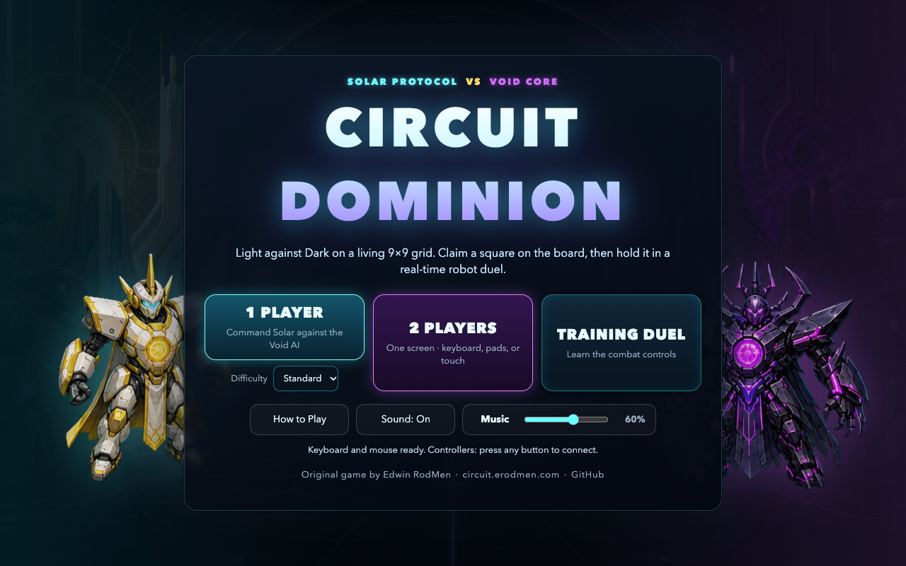
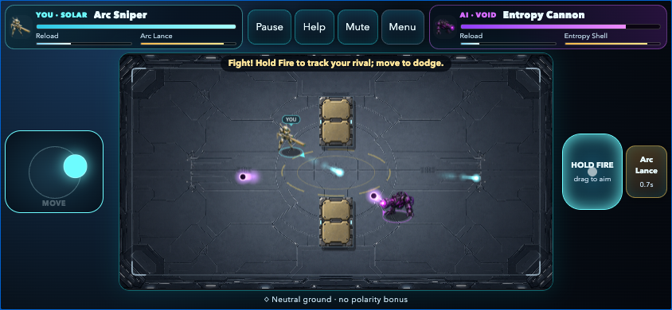

# Circuit Dominion

**An original game by Edwin RodMen ([VibezZzCoder](https://github.com/VibezZzCoder)).**
Source: https://github.com/VibezZzCoder/circuit-dominion

Circuit Dominion is a light-versus-dark robot strategy game. Two robot factions,
Solar Protocol and Void Core, fight over a living 9×9 grid. Claim a square on
the board, then hold it in a real-time duel: the winner keeps the square, and
the damage carries over to the next turn.

The robots, names, rules text, art, music, sound and code are all original to
this project.

## Play it

- **Online:** [circuit.erodmen.com](https://circuit.erodmen.com/)
- **Offline:** download `circuit_dominion.single-file.html` from the
  [Releases page](https://github.com/VibezZzCoder/circuit-dominion/releases) and
  open it in a browser. It's one file with every image, sound and script inside,
  so it plays with no internet connection.

Keyboard and mouse, touch (phones and tablets), and standard game controllers
all work. Two players can share one screen.

## Screenshots






## What's new in v1.0

v1.0 is a full overhaul of v0.2:

- **Duels:** new attack poses for all 12 robots, a top-down arena floor, slash
  and muzzle effects, telegraphed specials, impact sparks, damage numbers, KO
  and overtime banners, and screen shake.
- **Board:** a new framed board with animated Flux conduits, movement and attack
  animations, path previews, a duel preview card, and a zoom into each duel.
- **Audio:** an original procedural chiptune soundtrack and 46 sound effects,
  with separate Music and Effects volume sliders.
- **Interface:** a new title screen, side panel, duel HUD, end screen with match
  stats, and one Help guide with a robot roster.
- **Phones:** a better fit in iPhone Safari, including a compact landscape duel
  layout, plus Home Screen support.
- **Fixes:** many rule, input and balance fixes.

## How to play

- **Turns:** select one of your robots, then a highlighted square. Moving onto
  an enemy starts a duel for that square.
- **Winning:** destroy the enemy Command Unit (the one with the gold crown), or
  occupy all five ⚡ Power Nodes at the end of your turn.
- **Light, Dark and Flux:** fighting on your own polarity gives +8% HP and
  damage, and hostile ground costs 6% damage. The 27 gold-dashed Flux squares
  shift together after each round: Neutral → Light → Neutral → Dark.
- **Power Nodes:** robots on a node repair 12% HP after their turn. Holding nodes
  charges Command points, which pay for Grid Lock, Field Repair and Emergency
  Relay.
- **Wounds carry over:** a battered winner can be picked off next turn.

Game modes: 1 Player against the Void AI (Easy, Standard or Hard), 2 Players on
one screen, and a Training Duel for learning the combat controls.

## Controls

| | Solar / Player 1 | Void / Player 2 |
|---|---|---|
| Move | `WASD` | Arrow keys |
| Fire (hold) | `Space`, `F`, or left mouse | `Enter` or `/` |
| Special | `Left Shift` or right mouse | `Right Shift` |
| Aim | Mouse in the arena (otherwise aim assist) | Aim assist |

- **Board:** click or tap a robot, then a square. With the keyboard, arrows move
  the cursor and Enter selects.
- **Touch:** drag on MOVE to steer. Hold FIRE to attack, or drag on FIRE to aim
  by hand. Tap SPECIAL when it's ready.
- **Controller:** the left stick moves and the right stick aims. Hold A or RT to
  fire, press X or LB for Special, and press Start to pause. The first connected
  controller is Solar and the second is Void.
- **Shortcuts:** `H` opens Help, `Esc` pauses a duel, and `R` twice restarts.

## The robots

| Solar Protocol | Void Core |
|---|---|
| Core Commander | Null Overlord |
| Photon Striker | Razor Crawler |
| Arc Sniper | Entropy Cannon |
| Shield Drone | Glitch Wraith |
| Pulse Medic | Corruptor Bot |
| Nova Walker | Gravity Bruiser |

## Run and build from source

The game is plain HTML, CSS and JavaScript, with no install step. Serve the
folder with any static server:

```sh
python3 -m http.server 8787 --bind 127.0.0.1
```

Then open http://127.0.0.1:8787/index.html.

To build the release folder and the all-in-one single file:

```sh
node scripts/build-release.mjs
```

The build also checks that the release still carries the game's credits and
licence notice, and it refuses to finish if they're missing.

To run the tests (Node 22 or later; the browser tests also need Chrome or
Chromium):

```sh
node scripts/sanity-tests.mjs
node scripts/origin-tests.mjs
node scripts/platform-tests.mjs
node scripts/input-tests.mjs
node scripts/combat-control-tests.mjs
node scripts/audio-tests.mjs
node scripts/presentation-tests.mjs
node scripts/pose-art-tests.mjs
node scripts/cover-art-tests.mjs
node scripts/matchup-simulations.mjs
node scripts/release-tests.mjs
node scripts/browser-e2e-tests.mjs
```

## Licence

Copyright (C) 2026 Edwin RodMen.

Circuit Dominion is free software under the GNU General Public License,
version 3 or later ([LICENSE](LICENSE)), **with additional attribution terms
under section 7** ([NOTICE.md](NOTICE.md)). In short:

- You may play, study, change, share and host the game, including changed
  versions, under the GPL.
- Every copy must keep the credit to Edwin RodMen (VibezZzCoder) and the link
  to this repository. That includes the credit in the game itself.
- Changed versions must say they're changed, for example "Based on Circuit
  Dominion by Edwin RodMen". They may not use the name Circuit Dominion on its
  own.
- Nobody may present this work, or its art, as their own.

The licence covers the code, art, audio, interface text, and the faction and
unit names. The game comes with no warranty.
