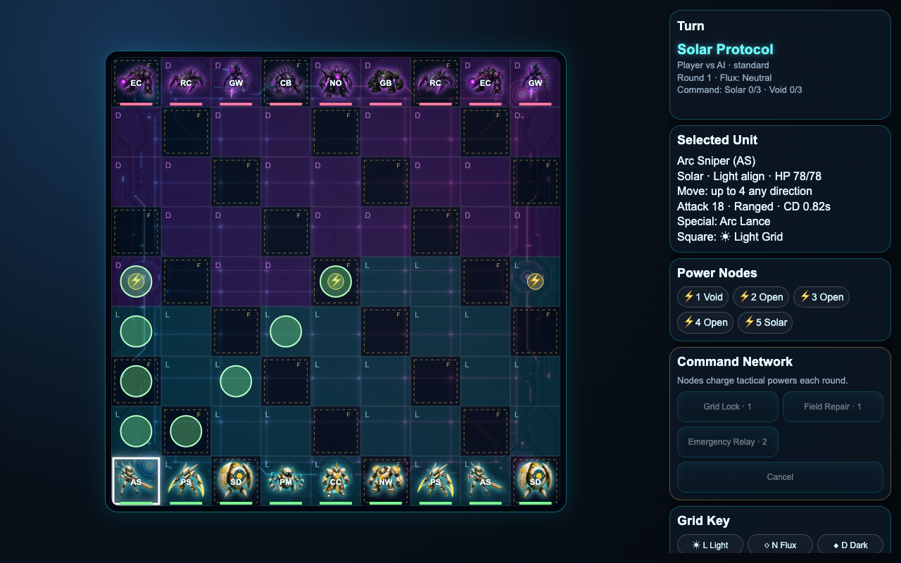
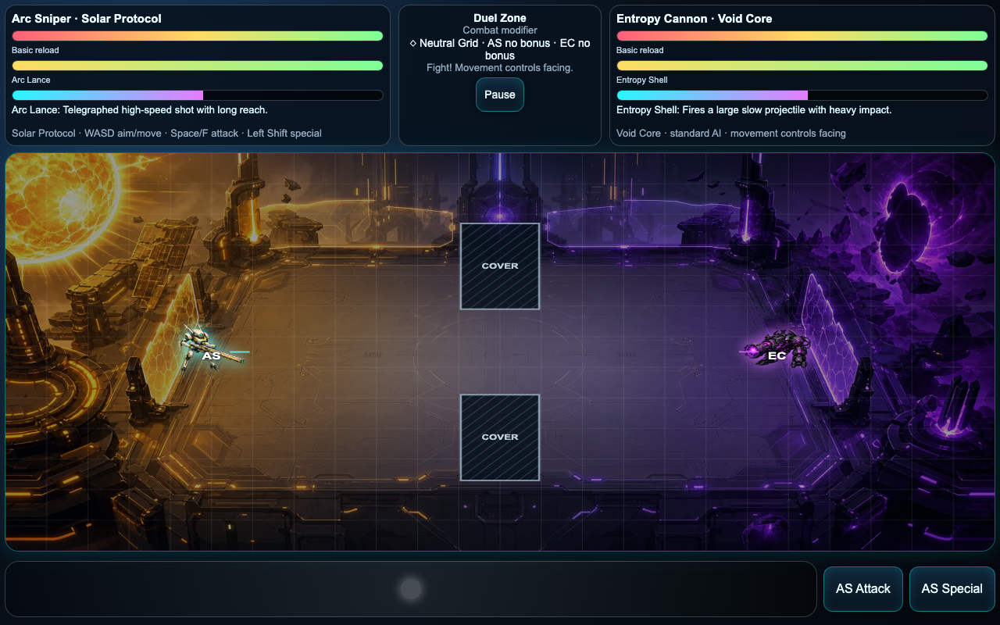

# Circuit Dominion

Browser game inspired by the gameplay structure of classic board-strategy/action-duel games like Archon, but with an original AI robots theme, original units, original names, original visuals, and no copyrighted assets.

Circuit Dominion is a tactical 9x9 board strategy game with real-time duel resolution between robot factions:
- Solar Protocol
- Void Core

## Screenshots

### Strategic Board



### Real-Time Combat



Fresh gameplay captures from the September 2026 release are included above.

## Gameplay Highlights

- Exact 27 Light / 27 Dark / 27 Flux board distribution
- Global Flux cycle: Neutral -> Light -> Neutral -> Dark
- Five Power Nodes with healing, Command charge, and objective victory
- Grid Lock, Field Repair, and Emergency Relay Command powers
- Persistent unit HP between board turns and real-time duels
- Directional attacks, finite projectile range, cover, collision, telegraphed
  specials, and escalating overtime
- Easy, Standard, and Hard AI without hidden stat bonuses

## Project Structure

- `index.html`: source entry point
- `src/`: gameplay, combat, rendering, input, UI, AI, platform, state modules
- `styles/main.css`: styling and responsive layout
- `assets/live/`: public local runtime backgrounds, sprites, and asset manifest
- `release/`: deployable build (modular `release/index.html`) plus the generated
  all-in-one `release/circuit_dominion.single-file.html`
- `scripts/build-single-file.mjs`: generates the single-file build from source

## Play it here

[Play Circuit Dominion](https://vibezzzcoder.github.io/circuit-dominion/)

Or play the single-file build inside the release folder.

NOTE: `release/circuit_dominion.single-file.html` is a true all-in-one build: the CSS,
all `src/` modules, and every image are inlined (images as data URIs), so it runs
offline from a single file with the full art. Regenerate it after source/asset
changes with `node scripts/build-single-file.mjs` (also run by `node scripts/build-release.mjs`).

## Local Build and Verification

Run `python3 -m http.server 8787 --bind 127.0.0.1`, then open
`http://127.0.0.1:8787/index.html` for source play or
`http://127.0.0.1:8787/release/index.html` for the generated release.

Before distributing a changed build, run:

```sh
node scripts/sanity-tests.mjs
node scripts/platform-tests.mjs
node scripts/matchup-simulations.mjs
node scripts/build-release.mjs
node scripts/release-tests.mjs
node scripts/browser-e2e-tests.mjs
```

The build verifies source/release byte parity, exact filenames, the GPL notice,
local assets, and the single-file output. Browser tests require Chrome/Chromium
and localhost permissions. `node scripts/compare-hosted.mjs` compares public
hosted files with the local release without changing anything remotely.

For publication, use the generated `release/` contents, with its `index.html`
as the online entry point. Include corresponding GPL source when distributing;
keep local drafts and QA captures under `assets/work/` out of the upload.
Publication remains a manual owner action. Physical iPhone and human-play
acceptance checks are in [the device checklist](docs/DEVICE_CHECKLIST.md).

## Controls

### Board
- Mouse/touch: select unit and destination square
- `H`: open help
- `R`: restart current mode
- `` ` ``: toggle debug overlay

### Duel
- Solar (P1):
  - Move: `WASD`
  - Attack: `Space` or `F`
  - Special: `Left Shift`
- Void (P2 in PvP):
  - Move: Arrow keys
  - Attack: `Enter` or `/`
  - Special: `Right Shift`
- Mobile touch:
  - Virtual stick + Attack/Special buttons
- `Esc`: pause/resume duel

## Game Modes

- Player vs AI
- Player vs Player

PvAI invariant: human always controls Solar in duels; AI always controls Void, regardless of who initiated combat.

## Win Conditions

- Destroy enemy Command Unit
- Occupy all five Power Nodes at the end of a turn

## Unit List

### Solar Protocol
- Core Commander
- Photon Striker
- Arc Sniper
- Shield Drone
- Pulse Medic
- Nova Walker

### Void Core
- Null Overlord
- Razor Crawler
- Entropy Cannon
- Glitch Wraith
- Corruptor Bot
- Gravity Bruiser

## Polarity and Power Nodes

Board squares are:
- ☀ Light Grid
- ◆ Dark Grid
- ◇ Neutral Grid

Combat modifiers:
- Aligned polarity: +8% HP and damage
- Hostile polarity: -6% damage
- Neutral: no modifier

The 27 Flux squares advance after both factions complete a turn:

`Neutral -> Light -> Neutral -> Dark`

Units standing on Power Nodes recover 12% maximum HP after their faction's
turn. Controlling nodes also charges the three-point Command meter used for
Grid Lock, Field Repair, and Emergency Relay.

## License

Circuit Dominion is licensed under the GNU General Public License v3.0 or later.

You may play, study, modify, share, redistribute, and host this game under the terms of the GPL-3.0-or-later license.

If you distribute modified versions, you must provide the corresponding source code and keep the work under GPL-compatible terms.

The GPL permits commercial distribution, but it does not permit taking away recipients’ GPL rights. Anyone who receives a copy must retain the freedom to inspect, modify, and redistribute it.

Unless otherwise noted, this license applies to the entire project, including code, generated visuals, procedural audio, UI text, faction names, unit names, and game content.
